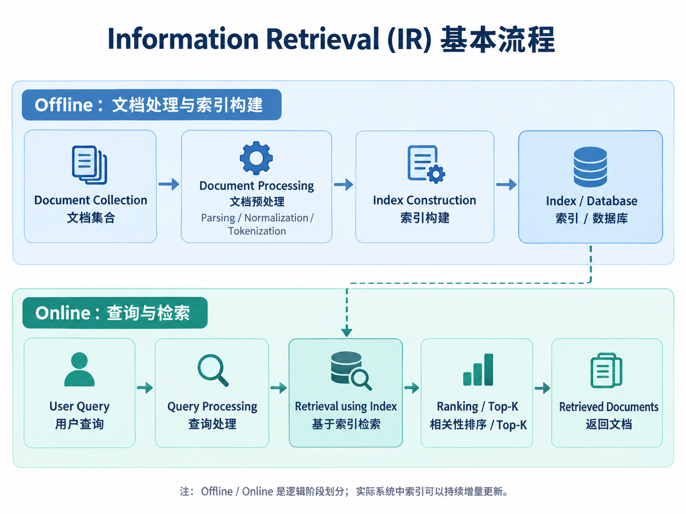

# Information Retrieval（IR）总览

## 1. 什么是 Information Retrieval

Information Retrieval（信息检索，IR）的目标是：

> 根据用户的查询（Query），从一个文档集合（Document Collection）中高效找到与信息需求相关的文档，并按照相关性进行返回。

IR 不只发生在用户发起查询的时候。一个完整的 IR 系统通常包含两个逻辑阶段。



### Offline：文档处理与索引构建

核心任务包括：

- 文档解析
- 编码与格式处理
- 文本规范化
- Tokenization
- 构建倒排索引或向量索引
- 保存检索所需统计信息

### Online：查询与检索

核心任务包括：

- 查询预处理与 Tokenization
- 查询表示构建（关键词或向量）
- 基于索引检索候选文档
- 相关性评分与排序
- 结果过滤与 Top-K 选择

## 2. 传统 Information Retrieval 的核心内容

传统 IR 主要围绕词项、索引和统计相关性展开。

主要内容包括：

1. **Document Processing**
   
   - 编码与格式解析
   - Unicode / UTF-8
   - Tokenization
   - Text Normalization
   - Stemming / Lemmatization
   - Document Classification

2. **Boolean Retrieval**
   
   - Term-Document Matrix
   - AND / OR / NOT
   - 二元匹配

3. **Inverted Index**
   
   - Dictionary
   - Posting List
   - Document Frequency
   - Intersect Algorithm
   - Skip Pointers

4. **Query Processing**
   
   - Posting List 合并
   - 按 DF 优化执行顺序
   - Phrase Retrieval
   - Positional Index

5. **Ranked Retrieval**
   
   - Jaccard Similarity
   - TF
   - IDF
   - TF-IDF
   - Vector Space Model
   - Cosine Similarity
   - BM25

## 3. 现代向量检索

现代检索系统通常不再只依赖词项是否完全匹配，而是使用神经网络模型把文本映射为向量。

基本流程：

```text
Documents
    ↓
Embedding Model
    ↓
Document Vectors
    ↓
Vector Index
```

查询时：

```text
Query
  ↓
Embedding Model
  ↓
Query Vector
  ↓
ANN / Vector Search
  ↓
Candidates
  ↓
Reranker
  ↓
Top-K
```

现代系统中常见的组合方式是：

```text
Keyword Retrieval
        +
Vector Retrieval
        ↓
Fusion
        ↓
Reranker
        ↓
Final Ranking
```

这通常称为 **Hybrid Retrieval**。
