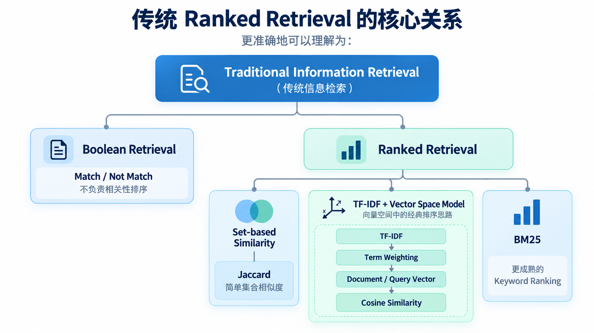

# Ranked Retrieval

## 1. 从 Boolean Retrieval 到 Ranking

Boolean Retrieval 只能回答：

```text
这个文档是否满足查询条件？
```

但真实检索系统通常还需要回答：

```text
哪个文档更相关？
```

因此需要为候选文档计算相关性分数，并按照分数排序。

## 2. Jaccard Similarity

Jaccard 用于比较两个集合的重合程度。

公式：

```text
J(Q, D) = |Q ∩ D| / |Q ∪ D|
```

例如：

```text
Query:
{machine, learning, model}

Document:
{machine, learning, algorithm, python}
```

则：

```text
Intersection = 2
Union = 5
Jaccard = 2 / 5 = 0.4
```

特点：

- 简单
- 分数范围 0～1
- 不考虑 Term Frequency
- 不考虑词的全局稀有程度
- 不考虑词序
- 不理解语义

## 3. Term Frequency（TF）

TF 表示 Term 在某个文档中出现的次数。

基础形式：

```text
TF(t, d) = count(t, d)
```

但词频与重要性通常不是线性关系。

因此常使用 Log TF：

```text
TF_log(t, d) = 1 + log(TF(t, d))
```

当 `TF > 0` 时成立。

它用于削弱极高词频带来的影响。

## 4. Inverse Document Frequency（IDF）

IDF 衡量 Term 在整个文档集合中的区分能力。

基础公式：

```text
IDF(t) = log(N / DF(t))
```

其中：

- `N`：文档总数
- `DF(t)`：包含 Term `t` 的文档数量

如果某个词出现在几乎所有文档中，它的 IDF 很低。

如果某个词只出现在少量文档中，它的 IDF 较高。

因此：

```text
common term  -> low IDF
rare term    -> high IDF
```

## 5. TF-IDF

TF-IDF 综合考虑：

- 一个 Term 在当前文档中出现得有多频繁
- 这个 Term 在整个文档集合中有多稀有

基础形式：

```text
TF-IDF(t, d)
=
TF(t, d) × IDF(t)
```

因此一个词如果：

- 在当前文档出现很多次
- 但在其他文档很少出现

通常会获得较高权重。

## 6. Vector Space Model

可以把每个文档表示成一个高维向量。

每个维度对应一个 Term：

```text
D =
[w1, w2, w3, ..., wn]
```

其中权重可以使用 TF-IDF。

Query 也可以表示为相同空间中的向量。

这样可以通过向量相似度计算 Query 与 Document 的相关性。

## 7. Cosine Similarity

常见相似度：

```text
cos(Q, D)
=
(Q · D) / (||Q|| ||D||)
```

它比较两个向量的方向，而不是只比较绝对长度。

优点之一是可以减轻文档长度差异带来的影响。

## 8. BM25

BM25 是经典且非常重要的词项相关性排序方法。核心思想仍然来自：TF-IDF，但它进一步处理两个问题。

### Term Frequency Saturation

一个词从出现 1 次增加到 5 次通常很重要。但从 100 次增加到 104 次，并不应该继续线性增加大量相关性。BM25 对 TF 做饱和处理。

### Document Length Normalization

长文档天然更容易出现更多 Query Terms。BM25 会根据文档长度与平均文档长度进行归一化。

简化理解：

```text
BM25 = IDF × TF Saturation × Document Length Normalization
```

因此 BM25 通常比基础 TF-IDF 更适合作为实际全文检索排序函数。

## 9. 传统 Ranked Retrieval 的核心关系

可以把它理解为：


