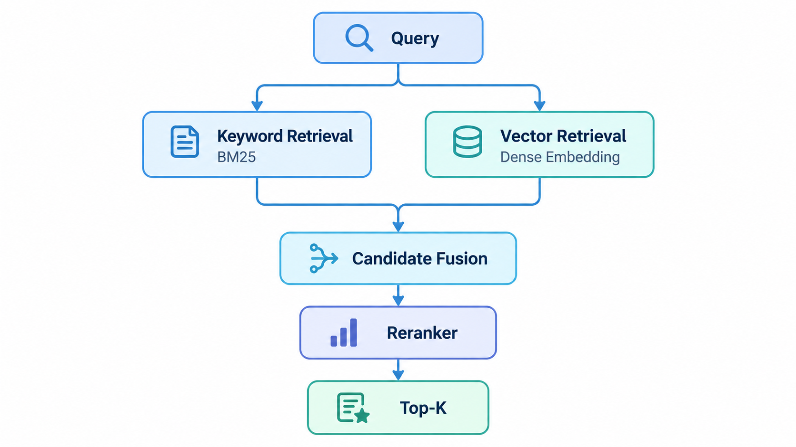

# Modern Vector Retrieval

## 1. 为什么需要 Vector Retrieval

传统 Keyword Retrieval 主要依赖词项重合。

例如：

```text
Query:
car repair

Document:
automobile maintenance
```

两个文本可能语义高度相关，但词项几乎没有直接重合。

Dense Vector Retrieval 的目标是：

> 将 Query 和 Document 映射到一个语义向量空间，在向量空间中进行相似度检索。

## 2. Embedding

Embedding Model 将文本转换成固定维度向量。

例如：

```text
"machine learning"
        ↓
Embedding Model
        ↓
[0.12, -0.45, 0.88, ...]
```

语义相近的文本通常在向量空间中距离更近。

## 3. Document Indexing

构建阶段：

```text
Documents
    ↓
Chunking
    ↓
Embedding Model
    ↓
Document / Chunk Vectors
    ↓
Vector Index
```

实际 RAG 系统通常索引 Chunk，而不是整个长文档。

## 4. Query Retrieval

查询阶段：

```text
Query
   ↓
Embedding Model
   ↓
Query Vector
   ↓
Vector Search
   ↓
Top-K Candidates
```

常见相似度：

- Cosine Similarity
- Dot Product
- Euclidean Distance

具体使用哪一种，需要与 Embedding Model 的训练方式保持一致。

## 5. ANN

如果数据库中有数百万甚至更多向量，逐个计算相似度成本很高。

因此通常使用：

**Approximate Nearest Neighbor（ANN）**

常见索引结构包括：

- HNSW
- IVF
- Product Quantization 相关方法

ANN 的核心思想是：

> 牺牲少量精确性，以显著降低搜索成本。

## 6. Dense Retrieval 的优点与限制

### 优点

- 可以捕获语义相似性
- 不要求 Query 和文档使用完全相同的词
- 对自然语言查询更加友好

### 限制

- 精确关键词匹配有时弱于传统检索
- 对编号、型号、专业术语可能不稳定
- Embedding 计算成本更高
- 向量索引需要额外存储
- Embedding Model 的选择直接影响检索质量

## 7. Hybrid Retrieval

现代系统常把两种方法结合：

```text
Keyword Retrieval
        +
Dense Retrieval
        ↓
Candidate Fusion
```

Keyword Retrieval 擅长：

- 精确词项
- 专有名词
- 产品编号
- 数值
- 特定术语

Dense Retrieval 擅长：

- 语义相似
- 同义表达
- 自然语言问题

二者结合通常比只使用一种方法更加稳健。

## 8. Result Fusion

Keyword 和 Vector Retrieval 会产生不同的排序结果。需要进行结果融合。

常见方法之一是：`Reciprocal Rank Fusion（RRF）` 它主要根据文档在多个结果列表中的排名进行融合，而不是直接比较不同系统的原始分数。

## 9. Reranking

Retriever 的主要目标通常是：

> 快速得到一个质量较高的 Candidate Set。

之后可以使用更强但更慢的模型重新排序。

典型流程：

```text
Query
  ↓
Retriever
  ↓
Top 50 / Top 100 Candidates
  ↓
Reranker
  ↓
Top 5 / Top 10
```

常见 Reranker：

- Cross-Encoder
- Transformer-based Reranker
- LLM-based Reranker

Retriever 更强调：

```text
Speed + Recall
```

Reranker 更强调：

```text
Precision + Ranking Quality
```

## 10. 一个现代检索系统

一个常见架构可以表示为：



这也是很多现代搜索系统和 RAG Retrieval Pipeline 的基础结构。

## 11. Retrieval Evaluation

检索系统最终需要通过评估确定效果。

常见指标包括：

- Precision
- Recall
- Recall@K
- Precision@K
- MRR
- MAP
- NDCG

对于现代 RAG Retrieval，尤其需要关注：

```text
Recall@K
```

因为 Retriever 首先需要确保真正相关的信息能够进入 Candidate Set。之后再由 Reranker 提升排序质量。
