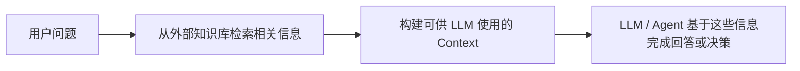
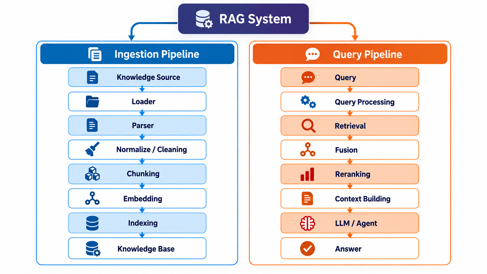
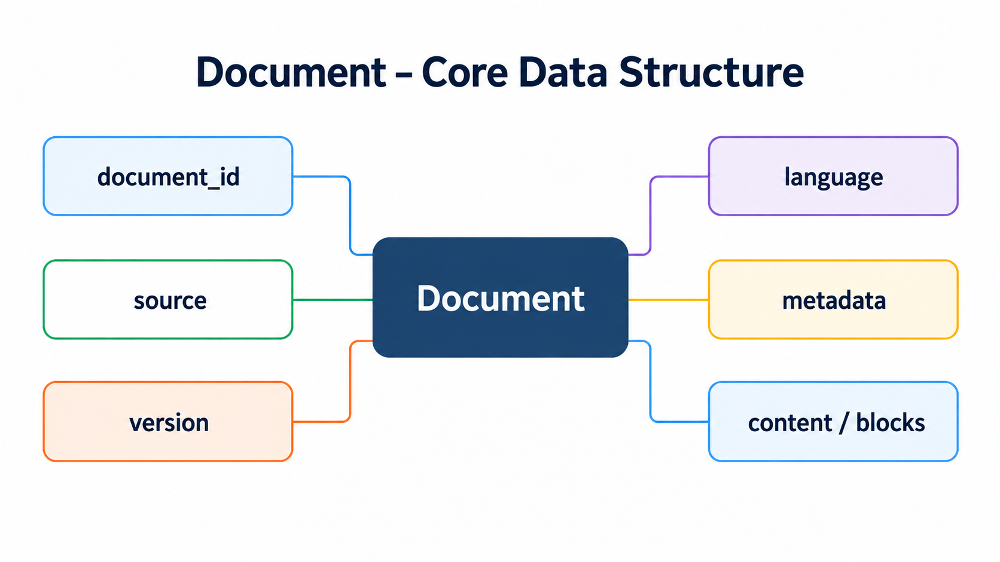
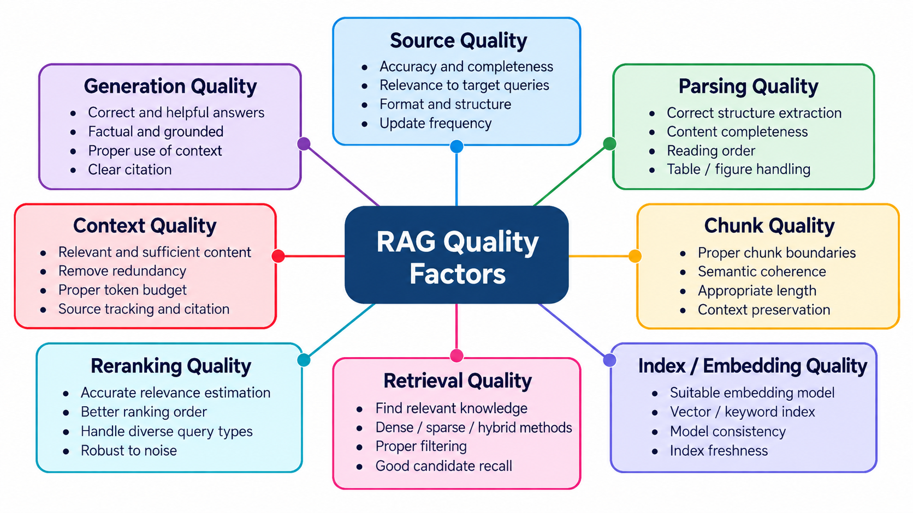

# RAG 总体体系与架构

## 1. RAG 是什么

**RAG = Retrieval-Augmented Generation，检索增强生成。**

核心思想：



RAG 的主要价值包括：

- 让 LLM 使用私有知识或领域知识
- 让知识可以独立于 LLM 参数进行更新
- 为回答提供可追踪的来源
- 通过可靠外部知识降低幻觉风险

需要注意：

> RAG 可以降低幻觉，但不能保证完全消除幻觉。知识库质量、Retrieval 质量和生成阶段都会影响最终结果。

## 2. RAG 的完整生命周期

一个完整 RAG 系统可以分成两条主链：



## 3. RAG 的核心数据对象

### 3.1 Document

Document 表示一个**逻辑上的完整知识来源**，可以是 PDF、Markdown、HTML、Word、数据库记录或 API 返回内容，不一定等同于一个物理文件。

典型信息：



其中，`source` 记录来源，`version` 用于追踪更新，`metadata` 保存标题、时间等扩展信息。具体字段可按系统需求选择。

### 3.2 ParsedDocument（结构化文档）

ParsedDocument 是 Parser 输出的**统一中间表示**（Intermediate Representation）。它保留文本内容及必要的文档结构，使后续处理不必直接面对 PDF、HTML 等不同原始格式。

典型结构：

```text
ParsedDocument
├── document_id
├── source
└── pages / sections
    └── blocks
        ├── type
        ├── text
        ├── order
        ├── structure
        ├── bbox（可选）
        └── metadata
```

Block 可表示 Heading、Paragraph、List、Table、Image、Caption 等内容。`Page`、`bbox` 对 PDF 等具有页面布局的文档尤其重要；并非所有数据源都必须具备页面或坐标信息。

### 3.3 Chunk

Chunk 是检索系统的**基本知识单元**，通常由 Chunker 根据结构化文档生成。一个 Document 可以包含多个 Chunk。

```text
Chunk
├── chunk_id
├── document_id
├── content
├── metadata
└── source_reference
```

好的 Chunk 应尽可能保持语义完整，并保留标题层级、页码或原始 Block 引用等必要上下文。Chunk 的边界不一定与段落或页面边界一致。

### 3.4 Embedding

Embedding 是文本通过模型得到的稠密向量表示，可用于语义相似度检索。

```text
Chunk / Query
     ↓
Embedding Model
     ↓
[0.13, -0.72, 0.44, ...]
```

- **Chunk Embedding**：一般在知识入库时生成并保存。
- **Query Embedding**：一般在查询时生成。

两者应使用相同或兼容的向量空间。Embedding 是一种表示，不一定需要单独定义为业务数据对象。

### 3.5 RetrievalResult

Retriever 返回的候选结果可以抽象为：

```text
RetrievalResult
├── chunk
├── score
├── retrieval_method
└── source_reference / metadata
```

`score` 表示某一检索或排序阶段的相关性分数。BM25 分数、向量相似度和 Reranker 分数的含义与尺度可能不同，不能未经处理就直接比较。

## 4. RAG 的核心组件

### 4.1 Knowledge Ingestion：知识处理与索引构建

这一阶段将原始数据转换为能够被检索的知识单元。

| 组件 | 核心职责 | 典型输出 |
|---|---|---|
| **Loader** | 从文件、对象存储、数据库、Web 或 API 获取数据 | 原始内容及来源信息 |
| **Parser** | 提取内容与结构，统一不同文档格式 | ParsedDocument |
| **Normalizer / Cleaner** | 规范化文本与元数据，处理重复或无关内容 | 清理后的结构化内容 |
| **Chunker** | 按结构、语义和 Token 长度组织检索单元 | Chunk[] |
| **Embedder** | 使用模型生成稠密向量 | Embedding Vector |
| **Indexer / Storage** | 持久化 Chunk、元数据与向量，构建检索索引 | 可查询的知识库 |

**几个重要边界：**

- **Loader vs. Parser**：Loader 解决“从哪里、如何读取”，Parser 解决“内容及结构是什么”。简单系统可以合并实现，职责仍应区分。
- **Parser vs. Chunker**：Parser 尽可能还原原始内容及结构；Chunker 根据检索需求重新组织内容，不应重新实现文档格式解析。
- **Normalizer / Cleaner**：可以是独立阶段，也可以集成在 Parser 或 Chunker 中；不应为了清理而丢失标题、表格或来源等有价值的信息。
- **Chunker**：除控制 Token 长度外，还需关注 Heading 上下文、语义边界、表格及图片关联；Overlap 只是可选策略。
- **Embedder vs. Indexer**：Embedder 生成向量，Indexer / Storage 负责数据保存及搜索索引维护，两者职责不同。

索引不只有向量索引：

- **Sparse / Keyword Index**：基于分词结果构建关键词到文档或 Chunk 的映射，并维护检索所需统计信息。
- **Vector Index**：基于 Embedding 支持向量相似度搜索；可采用精确搜索或近似最近邻搜索（ANN）。

### 4.2 Query & Retrieval：查询与检索

这一阶段处理用户 Query，并从知识库获取最相关的内容。

| 组件 | 核心职责 |
|---|---|
| **Query Processor** | 查询规范化、分词、向量化及检索条件准备 |
| **Retriever** | 利用关键词索引、向量索引等找到候选 Chunk |
| **Fusion** | 合并多个 Retriever 的结果、去重并融合排名 |
| **Reranker** | 对有限数量的候选结果进行更精细的相关性重排 |
| **Context Builder** | 选择、去重和组织内容，控制 Token Budget，并保留来源引用 |

典型流程：

```text
                     Query
                       ↓
                Query Processing
                       ↓
          ┌────────────┴────────────┐
          ↓                         ↓
   Dense Retriever           Sparse Retriever
          └────────────┬────────────┘
                       ↓
                     Fusion
                       ↓
                    Reranker
                       ↓
                 Context Builder
                       ↓
                     Context
```

**Fusion 和 Reranker 均为可选阶段**：只用一个 Retriever 时未必需要 Fusion；候选结果质量足够时也可以不使用 Reranker。Context Builder 的输出可交给下游 LLM 或 Agent，不要求二者部署在同一个服务中。

### 4.3 Generator / Agent

传统 RAG 通常将检索得到的 Context 与用户问题一起交给 LLM：

```text
Query + Context → Prompt → LLM → Answer
```

在 Agent 系统中，Retrieval 也可以作为一个 Tool 或知识服务，由 Agent 决定何时调用。**检索和生成的服务边界是一项架构选择，不是 RAG 的固定实现要求。**

## 5. Dense、Sparse 与 Hybrid Retrieval

| 方式 | 主要依据 | 典型优势 | 典型局限 |
|---|---|---|---|
| **Dense Retrieval** | Query 与 Chunk 的向量表示 | 语义相近、表达不同的文本 | 对精确编号或罕见术语可能不稳定 |
| **Sparse Retrieval** | 词项匹配及统计相关性，如 BM25 | 专有名词、错误码、产品编号、精确关键词 | 对同义改写与隐含语义较弱 |
| **Hybrid Retrieval** | Dense + Sparse 的互补结果 | 兼顾语义和精确匹配 | 需要处理重复候选及结果融合 |

BM25 本质上是一种**词项相关性评分方法**。实际检索通常先依靠倒排索引定位包含查询词的候选文档，再使用词频、文档长度和文档频率等统计信息进行评分和排序。

Hybrid Retrieval 通常通过 Fusion 组合两路结果。常见方法 **RRF（Reciprocal Rank Fusion）** 基于排名而非直接相加原始分数，适用于不同检索器分数不可直接比较的情况。

## 6. Metadata 与 Source Tracking

Chunk 不应只有纯文本。常见 Metadata 包括：


- document_id
- version
- language
- page_number
- heading_path
- chunk_type
- block_references
- source
- bbox（可选）

Metadata 的主要作用：

- **Filtering**：按来源、类型、语言、时间或访问权限限制检索范围。
- **Citation / Traceability**：从检索结果追踪到原始文档、页面及内容位置。
- **Lifecycle**：支持文档更新、版本管理和索引重建。
- **Debugging / Evaluation**：定位解析、切块和检索阶段的问题。

并不是所有 Metadata 都要复制到每个 Chunk。能通过 `document_id` 等关系获取的信息，可以根据查询效率和一致性要求决定是否冗余存储。

## 7. RAG 的质量与 Evaluation

RAG 的最终效果由多个阶段共同决定：



关键是**分阶段评估，而不是只看最终回答是否通顺**。

| 评估层次 | 关注问题 | 常见检查方式 |
|---|---|---|
| Parsing / Chunking | 内容是否完整，结构与 Chunk 边界是否合理 | 结构测试、样例检查 |
| Retrieval | 相关 Chunk 是否进入候选集，排名是否合理 | Recall@K、MRR、nDCG |
| Context | 证据是否充分、重复是否过多、引用是否正确 | Context 检查、引用核验 |
| Generation | 回答是否基于证据、是否遗漏或编造信息 | 有依据的答案评估 |

单元测试验证组件是否按预期执行；Evaluation 则验证整套检索与生成方案能否完成实际任务。两者都需要。

## 8. 整体理解框架

RAG 可以从逻辑上划分为 **Offline（知识准备）** 与 **Online（查询处理）** 两条流程.

Offline / Online 是**逻辑划分**，不代表系统只能批量离线构建索引；实际系统可以持续增量更新知识库。

> **核心原则：RAG 的重点不是 Vector Database 本身，而是把正确、相关、可追踪的知识在需要时检索出来，并可靠地提供给 LLM 或 Agent。**
